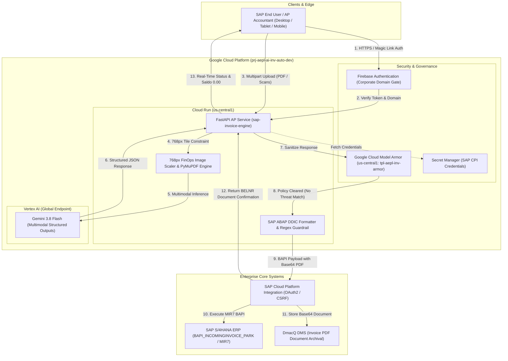
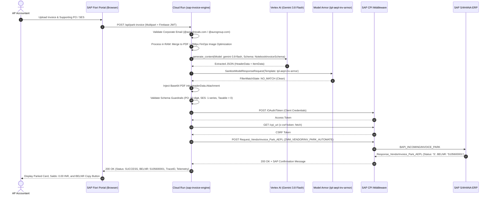
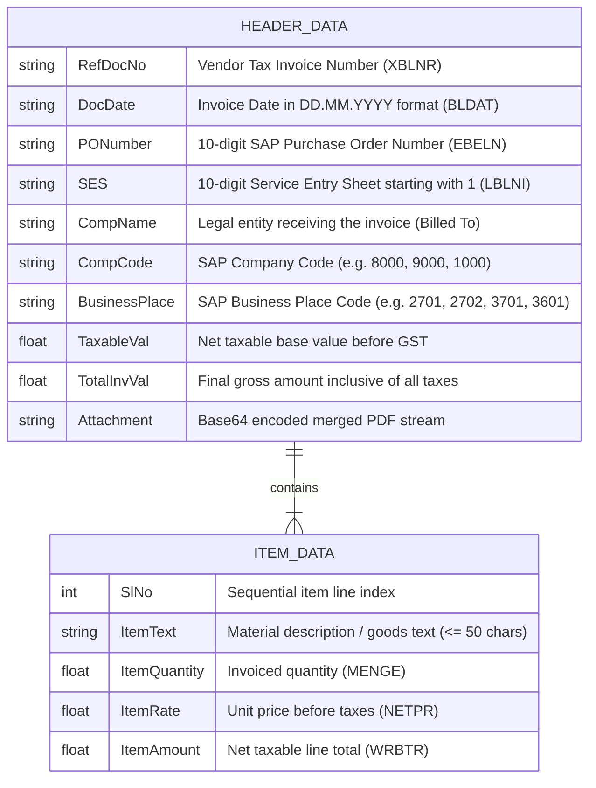

# AEPL Autonomous SAP Invoice Parking Engine

> Enterprise-grade Accounts Payable automation engine powered by Google Gemini 3.8 Flash, Google Cloud Model Armor, and SAP S/4HANA BAPI integration.

[](https://github.com/AuroGroupAutomationBot/aepl-invoice-automation/actions)
[](https://cloud.google.com/run)
[](https://cloud.google.com/vertex-ai)
[](https://cloud.google.com/security)
[](https://www.sap.com)
[]()

---

## Overview

In traditional corporate finance operations, Accounts Payable (AP) specialists spend thousands of hours manually entering vendor tax invoices into SAP S/4HANA using transactions such as `MIR7` (Park Incoming Invoice) and `MIRO` (Enter Incoming Invoice). This manual process introduces severe data entry bottlenecks, high operational costs, duplicate payment liabilities, and vulnerabilities to invoice fraud and prompt injection attacks embedded in digital invoice documents.

The **AEPL Autonomous SAP Invoice Parking Engine** solves this problem by delivering a zero-trust, event-driven serverless platform. Built on Google Cloud Run and Vertex AI, the engine ingests unstructured invoices (multi-page PDFs, scans, and mobile captures), extracts header and line-item data using **Gemini 3.8 Flash**, sanitizes the model output against prompt injection and malicious URIs via **Google Cloud Model Armor**, enforces strict SAP ABAP DDIC data types, and submits a balanced document directly to SAP S/4HANA via SAP Cloud Platform Integration (CPI) with automated attachment archiving in DmacQ DMS.

---

## What It Is Used For

* **Autonomous SAP MIR7 Invoice Parking**: Eliminates manual accounting data entry by extracting vendor invoice numbers, purchasing document numbers, line items, unit rates, quantities, and statutory taxes directly into SAP BAPI format.
* **Pre-BAPI 3-Way Match & Saldo Balance Verification**: Validates arithmetic balance ($\text{Gross Amount} = \text{Taxable Base} + \text{Tax Amount}$) with a real-time $\text{Saldo} = 0.00\text{ INR}$ verification indicator before downstream submission.
* **Adversarial Security Screening**: Protects enterprise ERP backends by screening uploaded invoices against multimodal prompt injection, hidden adversarial instructions, and untrusted URLs before executing BAPI calls.
* **DMS Document Archiving**: Merges multi-page invoice scans and Service Entry Sheets (SES) into a compressed PDF and injects the Base64 stream into SAP CPI for long-term archiving in DmacQ DMS.
* **Cross-Device Enterprise AP Portal**: Provides finance and procurement officers with an accessible, mobile-responsive SAP Fiori Horizon web portal to upload, monitor, and park invoices from any desktop, tablet, or phone.

---

## Architecture / How It Works

### High-Level System Architecture



### Detailed Request / Response Lifecycle



### Canonical SAP Invoice Data Model



---

## Key Features

* **Strict Alignment with AEPL Reference Notebook**: Follows the schemas, field naming conventions (`HeaderData`, `ItemData`), and pre-CPI validations established in `AEPL_Invoice_Parking_Automation_Using_Google_ADK.ipynb`.
* **Multimodal Extraction via Gemini 3.8 Flash**: Employs Vertex AI's `gemini-3.8-flash` model via the `global` publisher endpoint with structured outputs (`response_schema`), delivering low-latency parsing across multi-page tables and split scans.
* **Defense-in-Depth Security Screening**: Pre-BAPI output inspection by regional **Google Cloud Model Armor** (`tpl-aepl-inv-armor` in `us-central1`) protects against prompt injection, jailbreaking, and malicious links.
* **The 768px FinOps Rule**: Image inputs (PNG/JPG) are automatically scaled to $768\times 768$ pixels before inference, constraining visual token consumption to exactly 258 tokens per page ($75\%$ cost reduction compared to unscaled uploads).
* **Deterministic SAP ABAP DDIC Type Enforcement**: Automatic casting of numeric amounts to 2 decimal places, date normalization to `DD.MM.YYYY`, and string length bounding prevents downstream BAPI dumps.
* **10-Digit SAP PO & SES Regex Guardrails**: Hard firewall validating that `PONumber` is strictly a 10-digit integer (`^\d{10}$`) and `SES` is a 10-digit number starting with 1 (`^1\d{9}$`).
* **Direct Serverless Egress Architecture**: Cloud Run deployed with direct internet egress (`--clear-network`), eliminating VPC NAT gateways and dedicated static IP runtime costs.
* **Keyless CI/CD with Workload Identity Federation (WIF v2)**: GitHub Actions authenticates to Google Cloud via short-lived OIDC federated tokens (`wif-aepl-github-pool-v2`), completely eliminating static service account JSON keys.
* **Universal Cross-Device SAP Fiori Horizon Portal**: Fully responsive web application compatible with desktops, tablets, and smartphones, incorporating touch targets ($\ge 44\text{px}$), iOS zoom-prevention, horizontal momentum scrolling, and zero emoji rendering artifacts.
* **Corporate Single Sign-On Gating**: Passwordless email link authentication restricted exclusively to authorized enterprise domains (`@axisclinicals.com`, `@aurogroup.com`, `@ent.aurogroup.com`).

---

## Getting Started

### Prerequisites

* **Google Cloud SDK (`gcloud`)** installed and authenticated:
  ```bash
  gcloud auth login
  gcloud config set project prj-aepl-ai-inv-auto-dev
  ```
* **Python 3.11+** installed locally.
* **Docker** installed (optional, for local container emulation).

### Local Installation

1. **Clone the repository**:
   ```bash
   git clone https://github.com/AuroGroupAutomationBot/aepl-invoice-automation.git
   cd aepl-invoice-automation
   ```

2. **Create and activate a virtual environment**:
   ```bash
   python -m venv venv
   source venv/bin/activate  # On Windows: .\venv\Scripts\activate
   ```

3. **Install dependencies**:
   ```bash
   pip install --upgrade pip
   pip install -r requirements.txt
   ```

4. **Run the local development server**:
   ```bash
   uvicorn main:app --host 0.0.0.0 --port 8080 --reload
   ```

5. **Verify health endpoint**:
   ```bash
   curl http://localhost:8080/healthz
   ```

### Minimal Working Example: Parking an Invoice

Submit an invoice directly via `curl`:

```bash
curl -X POST "https://sap-invoice-engine-411369932113.us-central1.run.app/api/park-invoice" \
  -H "Authorization: Bearer <FIREBASE_ID_TOKEN>" \
  -F "files=@sample_invoice.pdf"
```

Expected JSON Response:
```json
{
  "status": "SUCCESS",
  "trace_id": "a1b2c3d4",
  "sap_message": "Document [5105600001] parked successfully in SAP S/4HANA (Company Code 1000, Fiscal Year 2026).",
  "extracted_data": {
    "HeaderData": {
      "RefDocNo": "INV-2026-0891",
      "DocDate": "26.10.2026",
      "PONumber": "4500123456",
      "SES": "1000456789",
      "CompName": "Auro Enterprises Private Limited",
      "CompCode": "8000",
      "BusinessPlace": "2701",
      "TaxableVal": 125000.00,
      "TotalInvVal": 147500.00
    },
    "ItemData": [
      {
        "SlNo": 1,
        "ItemText": "Industrial Solvent Drums Grade A",
        "ItemQuantity": 50.0,
        "ItemRate": 2500.0,
        "ItemAmount": 125000.0
      }
    ]
  },
  "telemetry": {
    "cpi_time": 0.842,
    "sap_time": 0.418,
    "pdf_size_mb": 0.185,
    "total_exec_time": 3.21,
    "submitted_by": "mohithsai.g@axisclinicals.com",
    "model": "gemini-3.8-flash"
  }
}
```

---

## Configuration

### Environment Variables

| Variable | Type | Default Value | Description |
| :--- | :--- | :--- | :--- |
| `GCP_PROJECT` | String | `prj-aepl-ai-inv-auto-dev` | Target Google Cloud Project ID. |
| `GCP_LOCATION` | String | `us-central1` | Default regional deployment zone. |
| `RUN_REGION` | String | `us-central1` | Cloud Run service execution region. |
| `VERTEX_LOCATION` | String | `global` | Regional/global endpoint for Vertex AI Gemini 3.8 Flash. |
| `GEMINI_MODEL` | String | `gemini-3.8-flash` | Multimodal foundational model identifier. |
| `MODEL_ARMOR_LOCATION` | String | `us-central1` | Regional location hosting Model Armor templates. |
| `MODEL_ARMOR_TEMPLATE` | String | `tpl-aepl-inv-armor` | Template resource ID for adversarial screening. |
| `ALLOWED_EMAIL_DOMAINS` | String | `ent.aurogroup.com;aurogroup.com;axisclinicals.com` | Semicolon-delimited authorized corporate domains. |
| `ALLOWED_EMAILS` | String | *(Whitelisted corporate users)* | Semicolon-delimited authorized employee email addresses. |

### Secret Manager Credentials

Configured in Cloud Run via `--set-secrets`:

| Secret Name | Key | Description |
| :--- | :--- | :--- |
| `SAP_TOKEN_URL:1` | `SAP_TOKEN_URL` | SAP OAuth 2.0 Client Credentials token issuance endpoint. |
| `SAP_CLIENT_ID:1` | `SAP_CLIENT_ID` | OAuth 2.0 client credential identifier. |
| `SAP_CLIENT_SECRET:1` | `SAP_CLIENT_SECRET` | OAuth 2.0 client credential secret. |
| `SAP_CPI_URI:1` | `SAP_CPI_URI` | Inbound SAP CPI HTTP endpoint (`ZMM_VENDORINV_PARK_AUTOMATE`). |

---

## Project Structure

```text
aepl-invoice-automation/
├── .github/
│   └── workflows/
│       └── deploy.yml            # Keyless CI/CD pipeline deploying to Cloud Run via WIF v2
├── AEPL_Invoice_Parking_Automation_Using_Google_ADK.ipynb  # Reference architectural notebook
├── Dockerfile                    # Hardened Python 3.11-slim container with non-root aepluser
├── index.html                    # Universal responsive SAP Fiori Horizon AP web portal
├── main.py                       # Core FastAPI service, Model Armor client, and SAP BAPI dispatcher
├── README.md                     # Technical architecture, setup, and deployment manual
└── requirements.txt              # Pinned production dependencies (FastAPI, GenAI, Model Armor, PyMuPDF)
```
